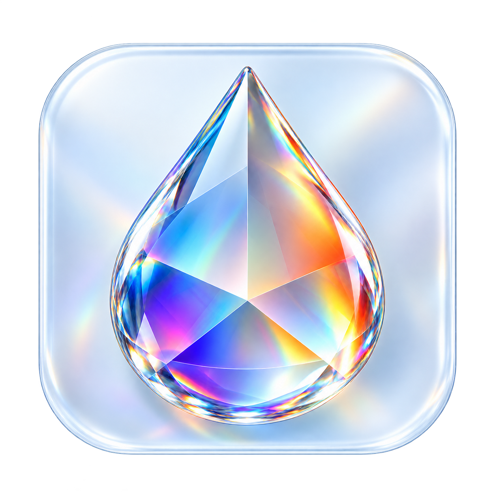
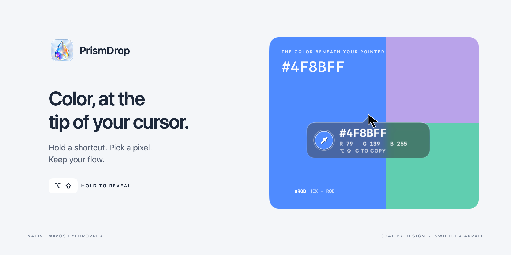
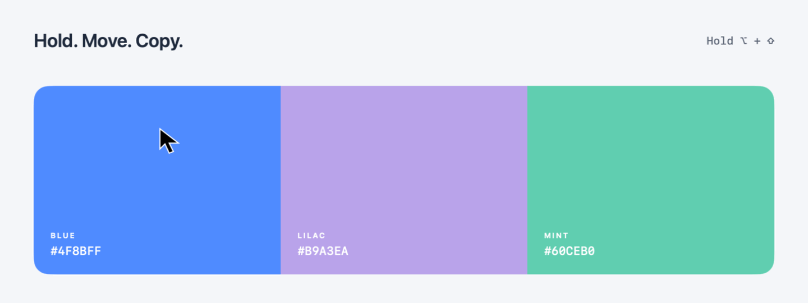

<p align="center">
  
</p>

<h1 align="center">PrismDrop</h1>

<p align="center"><strong>Color, at the tip of your cursor.</strong><br>A small native macOS eyedropper that appears while you need it.</p>

<p align="center">
  <a href="https://github.com/deadpoods/PrismDrop/actions/workflows/build.yml"></a>
  
  
  
</p>

<p align="center">
  <a href="#get-prismdrop">Get PrismDrop</a> ·
  <a href="docs/INSTALLATION.md">Setup & permissions</a> ·
  <a href="docs/ARCHITECTURE.md">How it works</a> ·
  <a href="docs/TROUBLESHOOTING.md">Troubleshooting</a>
</p>



## A color picker that stays in your flow

Hold **Option + Shift**. Move across your screen. PrismDrop follows the cursor with a compact glass bubble showing the captured pixel as uppercase **HEX** and **RGB**. Press **C** while holding to copy the HEX, then release either modifier to dismiss it.

| Hold | Copy | Release |
| :--- | :--- | :--- |
| **⌥ + ⇧** reveals the live readout | **C** copies `#RRGGBB` | Either modifier dismisses it |



<sub>Presentation previews render the app's actual SwiftUI overlay with scripted colors and cursor movement. They illustrate the interface; they are not recordings of pixel-capture performance.</sub>

## Small details, considered

- **Attached to the cursor.** A 186 × 62 point bubble sits beneath the pointer, joined by a centered arrow. It flips above near the bottom of a display and adjusts at side edges.
- **Real Liquid Glass.** On macOS 26 and later, the bubble uses Apple's native SwiftUI `glassEffect`. Earlier supported versions use an ultra-thin material.
- **A useful reading.** Uppercase sRGB HEX, decimal RGB, a live color swatch, and copy feedback in one compact view.
- **Native throughout.** SwiftUI, AppKit, Core Graphics, and ScreenCaptureKit. No package dependencies or web runtime.
- **Quiet when idle.** A menu bar icon provides the last color, alternate modifier pairs, permission status, and Quit. The app has no Dock window.
- **Local by design.** No network requests, analytics, saved screenshots, or audio capture. [Read the privacy notes →](docs/PRIVACY.md)
- **Motion with restraint.** A short reveal and dismissal respect the system's Reduce Motion setting.

## Get PrismDrop

### Download

Find the universal app in [GitHub Releases](https://github.com/deadpoods/PrismDrop/releases). Unzip it, move **PrismDrop.app** into `~/Applications`, and open it.

> The app is ad-hoc signed and **not notarized**. macOS may warn about a downloaded copy. You can inspect and build the source below, or use **System Settings → Privacy & Security → Open Anyway** for this app after reviewing it. [Full installation guide →](docs/INSTALLATION.md)

### Build from source

You need macOS, **Xcode 26 or its Command Line Tools or later**, and the macOS 26 SDK. The resulting universal app targets **macOS 14 and later**.

```sh
git clone https://github.com/deadpoods/PrismDrop.git
cd PrismDrop
./build.sh
./install.sh
```

The build uses `swiftc`, `lipo`, and `codesign`. Full Xcode is optional when a sufficiently recent Command Line Tools installation is selected.

### Allow two permissions

From PrismDrop's menu bar menu, request **Screen Recording** and **Input Monitoring**, then enable the installed app in **System Settings → Privacy & Security**. On newer macOS versions the first setting is named **Screen & System Audio Recording**. Quit and reopen PrismDrop after changing a grant.

If PrismDrop is missing from the recording list, click **+**, press **⌘ ⇧ G** in the file chooser, and enter `~/Applications/PrismDrop.app`. [Step-by-step setup →](docs/INSTALLATION.md#permissions)

## Make it yours

Use **Activation hotkey** in the menu to choose **Option + Shift**, **Control + Shift**, or **Control + Option**. The selected pair persists between launches. **Copy Last HEX** remains available after you dismiss the overlay.

PrismDrop observes input through a listen-only event tap. The copy chord can also reach the foreground app; it does not consume your keys. Some secure input fields or system shortcuts can limit global key observation.

## Accuracy and compatibility

PrismDrop samples a one-point screen region at the current display's backing scale, selects the corresponding backing pixel, and converts it to **8-bit sRGB**. That is the color represented by its six-digit HEX value. Capture and scheduling introduce latency; fast motion can outrun the latest sample. Wide-gamut and HDR colors are mapped into sRGB, and macOS may exclude protected content.

The app has been exercised on macOS 26 with a Retina display, including global activation, live values, copy, release, and permission recovery. Intel and Apple silicon binaries compile into the universal build. Older macOS versions, physical Apple silicon hardware, and multiple-monitor arrangements need further runtime coverage. [Architecture and validation details →](docs/ARCHITECTURE.md)

## Explore the project

| File | Purpose |
| :--- | :--- |
| [`Source/PrismDrop.swift`](Source/PrismDrop.swift) | The native app: input, capture, overlay, and menu |
| [`Assets/`](Assets/) | Glass prism droplet artwork and the macOS icon |
| [`build.sh`](build.sh) · [`install.sh`](install.sh) | Build a universal app and install it locally |
| [`docs/`](docs/) | Installation, architecture, privacy, and troubleshooting |
| [`CONTRIBUTING.md`](CONTRIBUTING.md) | Development and meaningful checks |
| [`CHANGELOG.md`](CHANGELOG.md) | Release history |
| [`SOURCE_LISTING.md`](SOURCE_LISTING.md) | A generated, readable source and configuration listing |

Built by [Aaryan Kumar](https://github.com/deadpoods). The icon combines a drop, optical prism facets, and glass refraction; its artwork was created with image generation and packaged locally for macOS. [Artwork notes →](Assets/README.md)
