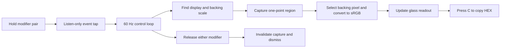

# Inside PrismDrop

[← Back to PrismDrop](../README.md)

PrismDrop is one native Swift application with no external packages. [`PrismDrop.swift`](../Source/PrismDrop.swift) contains the input listener, sampler, SwiftUI readout, panel positioning, and menu controller.

## From a held shortcut to a color

The control loop runs at 60 Hz; this is not a guarantee of 60 completed screenshot requests per second. Capture requests are serialized, and no queue of old frames accumulates. A generation counter invalidates in-flight results after release. Polling the current modifier state provides a release fail-safe if the event tap is temporarily disabled.

## Pixel coordinates and color

The sampler reads the global Core Graphics cursor position and identifies its display. It converts that position into display-local logical coordinates, captures the one-point cell at the current backing scale with cursor drawing disabled, then selects the backing pixel within that cell. Core Graphics converts the captured pixel to 8-bit sRGB bytes for `#RRGGBB` and decimal RGB.

The display list refreshes when an unknown monitor is encountered, and backing scale is read at each request. These paths are implemented, but physical multi-monitor and reconnection testing is still needed.

Six-digit HEX represents SDR sRGB. It cannot preserve all wide-gamut or HDR values. ScreenCaptureKit and macOS can exclude protected video or system content, and capture latency can leave a reading briefly behind a rapidly moving pointer.

## The cursor bubble

`OverlayView` draws a 186 × 62 point SwiftUI view. `CursorBubble` outlines the rounded box and its arrow as one continuous shape. `OverlayPanel` hosts it in a transparent, nonactivating `NSPanel` that ignores mouse events and follows the pointer directly.

The arrow normally sits at the center of the upper edge, about 3 points below the cursor. Near the bottom of the display the bubble flips above. At side edges the box is clamped to the display and the arrow shifts within the usable edge. No custom panel shadow or opaque dark backing is added.

On macOS 26 and later, `glassEffect(.regular.tint(...), in: bubble)` applies Apple's native Liquid Glass material. Older supported versions fall back to `.ultraThinMaterial`. Reduce Motion replaces the reveal spring with a short fade and shortens dismissal.

## Input and permission boundaries

The Core Graphics event tap is listen-only. It observes modifier changes and the optional copy key; it does not suppress input or synthesize events. Consequently, the copy chord can also reach the foreground app. Input Monitoring and Screen Recording are checked and exposed in the menu. Capture stops when required access is unavailable.

The diagnostic CLI is launched by a shell and can inherit Terminal's privacy attribution. Its permission lines may differ from those of the app launched through Finder or Launch Services. Use the installed app's menu to assess its grants.

## Validation status

| Check | Evidence / remaining coverage |
| --- | --- |
| Intel and Apple silicon compilation | Both slices build and are combined with `lipo`; the workflow verifies their presence. |
| Bundle configuration, scripts, signature, icon | Checked by `scripts/verify.sh`. Ad-hoc signing is not notarization. |
| Hotkey, live color, copy, release | Manually exercised on macOS 26 on a Retina display. |
| Native glass appearance | Inspected in real windows on macOS 26. |
| Permission recovery | Tested after changing local ad-hoc builds. |
| Older supported macOS, Apple silicon runtime, multiple displays, HDR, secure input | Further physical runtime testing needed. |

## Apple references

- [SwiftUI Liquid Glass](https://developer.apple.com/documentation/swiftui/view/glasseffect%28_%3Ain%3A%29)
- [ScreenCaptureKit single-frame capture](https://developer.apple.com/documentation/screencapturekit/scscreenshotmanager/captureimage%28contentfilter%3Aconfiguration%3Acompletionhandler%3A%29)
- [Source rectangle](https://developer.apple.com/documentation/screencapturekit/scstreamconfiguration/sourcerect) and [cursor visibility](https://developer.apple.com/documentation/screencapturekit/scstreamconfiguration/showscursor)
- [Screen capture sample and permission guidance](https://developer.apple.com/documentation/screencapturekit/capturing-screen-content-in-macos)
